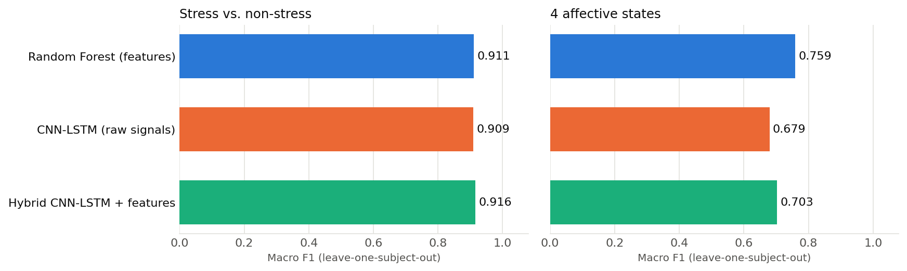
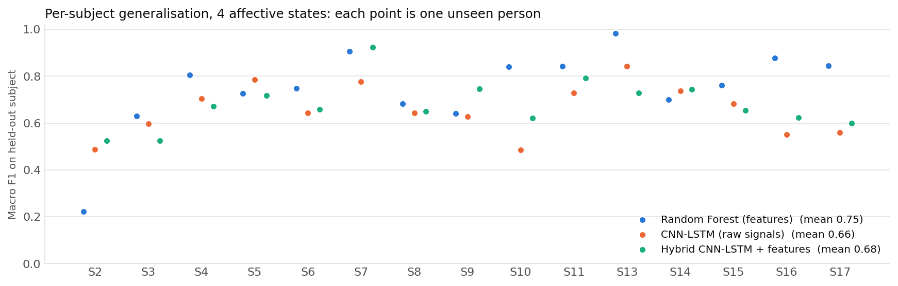

# Stress Detection from Wearable Sensors

[](https://github.com/Praruj/stress-detection/actions/workflows/ci.yml)


[](LICENSE)
[](https://colab.research.google.com/github/Praruj/stress-detection/blob/master/notebooks/04_colab_train.ipynb)

Classifying stress and affective states from 60 seconds of chest-sensor data
(ECG, EDA, EMG, temperature, respiration), **evaluated only on people the model
has never seen**.

| | |
|---|---|
| **92.7% accuracy** | stress vs. non-stress, held-out people (hybrid) |
| **0.76 macro-F1** | 4 states: baseline, stress, amusement, meditation (Random Forest) |
| **19% → 83%** | 4-state accuracy, first version vs. now |
| **15 / 15** | WESAD subjects, each tested once with leave-one-subject-out |



---

## Highlights

- **Strict, leakage-free evaluation.** Leave-one-subject-out over all 15 people.
  Normalisation statistics, feature scaling and early stopping only ever see training or
  validation subjects. Final models use untuned default settings, and the ablation reports validation
  *and* test scores side by side.
- **Three model families, compared honestly**: a Random Forest on hand-crafted physiological
  features, a CNN-LSTM on raw signals, and a **hybrid** that fuses both. All are run by one CLI.
- **Ablation study** of five CNN-LSTM regularisation settings. It shows the remaining error comes
  from person-to-person variation, not classic overfitting, which motivated the hybrid model.
- **Seed-robust results.** A single CNN-LSTM run swings by about ±0.05 macro-F1 from the random
  seed alone, so the final deep models are 5-seed ensembles.
- **Engineered like production code**: modular `src/` package, documented CLI, a pytest suite on
  synthetic WESAD-format data, GitHub Actions CI, and one-click reproduction on a free Colab GPU.

---

## Results

Leave-one-subject-out on all 15 WESAD subjects. Pooled metrics are over every held-out window.
Per-person F1 is the mean ± std of the 15 per-subject scores. Deep models are 5-seed ensembles.

| Model | Task | Accuracy | Macro-F1 | Per-person F1 |
|---|---|---|---|---|
| Random Forest (features) | Stress vs. non-stress | 92.5% | 0.911 | 0.904 ± 0.127 |
| CNN-LSTM (raw signals) | Stress vs. non-stress | 92.1% | 0.909 | 0.909 ± 0.088 |
| **Hybrid CNN-LSTM + features** | Stress vs. non-stress | **92.7%** | **0.916** | 0.917 ± 0.086 |
| **Random Forest (features)** | 4 states | **83.1%** | **0.759** | 0.747 ± 0.171 |
| CNN-LSTM (raw signals) | 4 states | 76.8% | 0.679 | 0.656 ± 0.104 |
| Hybrid CNN-LSTM + features | 4 states | 77.2% | 0.703 | 0.678 ± 0.099 |
| *v1 LSTM (archived)* | 4 states | 19.0% | 0.168 | 2 test subjects only |



**What the numbers say**

- **Stress detection on unseen people works: about 92% accuracy for all three models.** The hybrid is
  marginally best (macro-F1 0.916), but the three are within 0.007 of each other, which is in line with
  the 93% reported for chest sensors in the original WESAD paper. The real difference is the worst case:
  the hybrid's least-accurate person still scores 0.73 F1, against 0.59 for the Random Forest.
- **On 4 states the hand-crafted Random Forest has the best average** (0.759 vs. 0.703 for the hybrid). With
  about 2,400 training windows from 13 people per fold, domain features (heart rate, HRV, sweat
  responses, breathing rate) are hard to beat end-to-end.
- **The deep models fail more gracefully.** The Random Forest collapses on subject S2 (F1 0.22), while
  the hybrid's worst subject is 0.52 and its per-person spread is the smallest (±0.099 vs. ±0.171).
  Adding the features to the CNN-LSTM lifted its 4-state macro-F1 from 0.679 to 0.703.
- **Amusement is the hard class** (F1 0.43 RF / 0.34 hybrid / 0.26 CNN-LSTM). It is the shortest condition
  (about 6 minutes per person), and physiologically it sits close to baseline and meditation.
- **Single runs are noisy.** The same CNN-LSTM configuration scored 0.651 and 0.707 macro-F1 with two
  different seeds. The 5-seed ensembles report the expected performance rather than a lucky draw. For
  the hybrid, one single-seed run (0.724) beat its own ensemble (0.703).

### Ablation: does regularisation fix the CNN-LSTM?

Single-seed CNN-LSTM, 4-state task. Rows are ranked by **validation** F1 (the subject held out
for early stopping), which is how a setting would be picked without looking at test people.

| Setting | Val F1 | Test accuracy | Test macro-F1 |
|---|---|---|---|
| **e2** e1 + label smoothing 0.1, random 45 s crops, channel dropout 0.15 | 0.815 | 72.4% | 0.649 |
| **e0** baseline: lr 1e-3, dropout 0.3, weight decay 1e-3 | 0.798 | 75.9% | 0.707 |
| **e3** e2 with a half-width CNN (16 base channels) | 0.792 | 73.5% | 0.642 |
| **e1** lr 3e-4, dropout 0.5, weight decay 1e-2, 60 epochs | 0.791 | 74.6% | 0.662 |
| **e4** e2 with 2 validation subjects (val F1 not directly comparable) | 0.758 | 67.5% | 0.606 |

On test people, no regularisation setting beat the plain baseline. Lower learning rate, heavier
dropout and weight decay, label smoothing, random 45 s crops and channel dropout all scored at or below it.
Validation would have picked the augmented setting, which tested 0.06 F1 *worse*. With one validation
person per fold, the tuning signal is mostly noise, so the final models keep the untuned defaults. Note
that the defaults also happen to be best on test, so this choice is not fully independent of the test set.
Holding out a second validation subject cost more training data than it gained in early-stopping
stability. The gap is a *domain shift between people*, so the next step was to give the network
domain knowledge (the hybrid model) rather than more regularisation.

### From 19% to 83%: what was wrong with v1

The first model (`notebooks/03_split_and_train.ipynb`) scored 19% on four classes, below the
25% chance level.

1. **No per-subject normalisation.** Skin conductance and body temperature differ more *between
   people* than *between conditions*, so the model learned identities instead of states.
2. **An LSTM over 4,200 raw timesteps** cannot carry gradients that far. A CNN front-end now
   compresses the sequence 64× first.
3. **`x[::10]` downsampling aliased the ECG.** It is replaced by an anti-aliased `scipy.signal.decimate`.
4. **Two test subjects** made the metric very noisy. LOSO uses all 15.

---

## Method

```
WESAD .pkl, RespiBAN chest sensor @ 700 Hz
  │  anti-aliased decimation → 100 Hz
  │  per-subject z-score normalisation
  │  60 s windows, 15 s hop, inside one protocol block
  ▼
windows (N, 6000, 5) ──┬──► hand-crafted features: HR, SDNN, RMSSD, SCR count & amplitude,
                       │    breathing rate, EMG RMS, per-channel statistics
                       │       ├──► Random Forest
                       │       └──────────────┐
                       └──► CNN-LSTM encoder  │
                             Conv1d ×3 (pool 4 each: 6000 → 93 steps)
                             BiLSTM(64) → attention pooling
                                    ├──► linear head            = CNN-LSTM
                                    └──► concat(features MLP) → head = Hybrid
```

- **Imbalance:** class-weighted cross-entropy (amusement is the shortest condition).
- **Training:** AdamW with cosine LR, gradient clipping, early stopping on validation macro-F1,
  and gain + noise augmentation.
- **Validation subject:** for each fold, the next subject (cyclically) is held out for early stopping.

---

## Reproduce

**Google Colab (free T4 GPU, recommended):** click the *Open in Colab* badge, set
*Runtime → T4 GPU* and *Run all*. The notebook downloads WESAD (2.25 GB), trains every model
and downloads the results. That takes about 1.2 h with 5-seed ensembles, or about 20 min with `ENSEMBLE = 1`.

**Locally:**

```bash
python -m venv .venv && source .venv/bin/activate     # Windows: .venv\Scripts\activate
pip install -r requirements.txt
# download WESAD into ./WESAD (see data/README.md)

python -m src.data                                              # build windows
python -m src.train --model rf      --task 4class --eval loso
python -m src.train --model cnnlstm --task 4class --eval loso --ensemble 5 --tag final
python -m src.train --model hybrid  --task 4class --eval loso --ensemble 5 --tag final
python -m src.report                                            # summary.csv + figures
pytest -q                                                       # tests, no dataset needed
```

Every run writes `outputs/<model>_<task>_<eval>[_tag]/results.json` and a confusion matrix.
`python -m src.train --help` lists all options (`--crop`, `--chan-drop`, `--label-smoothing`,
`--width`, `--n-val`, `--ensemble`, ...).

---

## Project structure

```
stress-detection/
├── src/
│   ├── config.py      paths, channels, window sizes, task definitions
│   ├── data.py        load → filter → normalise → window   (python -m src.data)
│   ├── features.py    physiological features (HR, HRV, SCR, breathing rate, …)
│   ├── models.py      CNN-LSTM, Hybrid, v1 LSTM
│   ├── train.py       LOSO / split training, ensembling, evaluation   (python -m src.train)
│   └── report.py      summary.csv + README figures   (python -m src.report)
├── tests/             pytest suite on synthetic WESAD-format data
├── notebooks/         01 exploration · 02 preprocessing · 03 v1 (archived) · 04 Colab runner
├── outputs/           results.json + confusion matrix per run, summary.csv, figures/
├── data/README.md     dataset download instructions
└── .github/workflows  CI: runs the tests on every push
```

---

## Limitations and next steps

- **15 people in a lab.** WESAD is the standard benchmark but small. Real-world stress is
  messier, and these numbers should not be read as clinical accuracy.
- **Chest sensor only.** The wrist device (Empatica E4) data is unused. A wrist-only model is
  the realistic consumer setting.
- **Amusement is hard to separate** from baseline and meditation with physiology alone.
- Ideas: subject-adaptive calibration from a few minutes of baseline, self-supervised pretraining
  on unlabelled windows, and a small real-time demo.

## Dataset and citation

P. Schmidt, A. Reiss, R. Duerichen, C. Marberger, K. Van Laerhoven.
*Introducing WESAD, a Multimodal Dataset for Wearable Stress and Affect Detection.* ICMI 2018.
[Dataset page](https://ubi29.informatik.uni-siegen.de/usi/data_wesad.html). The data is not
redistributed here.

## Author

**Praruj Thapa**, ML & AI Engineer, Osaka.
[LinkedIn](https://www.linkedin.com/in/praruj-thapa) · [GitHub](https://github.com/Praruj) · thapa.praruj@gmail.com
